<div align="center">

# Parallax site

### Type a brief. Get a scroll-driven three.js website.

Claude Code is the only AI. It writes every scene, every word and every layout as code:<br>
no image models, no downloaded assets, no API keys, no extra costs.


<br>

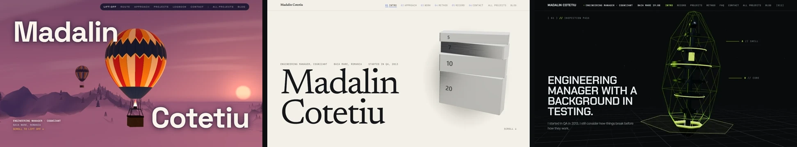

<sub><b>Film</b> &nbsp;·&nbsp; <b>Editorial</b> &nbsp;·&nbsp; <b>Signal</b>: three styles, one engine, all generated from a brief</sub>

<br><br>

[**Styles**](#three-styles) · [**Quick start**](#quick-start) · [**How it works**](#how-it-works) · [**Skills**](#the-skills) · [**Checks**](#checks) · [**Style guide**](STYLES.md)

</div>

---

## Three styles

The style is the first decision. It sets the layout, the menu and preloader, the type system, how much
of the page is pinned, and what the 3D does. Colors, fonts and sections come afterwards.
[STYLES.md](STYLES.md) compares them in depth.

### 🎬 Film: *one continuous take*

A 3D world fills the screen and the camera travels through it as you scroll. Sections pin and scrub
like scenes in a single shot, and one object or journey carries from the first frame to the last.

<table>
  <tr>
    <td width="33%" align="center">
      <a href="https://cotetiu-madalin-parallax-portfolio.vercel.app">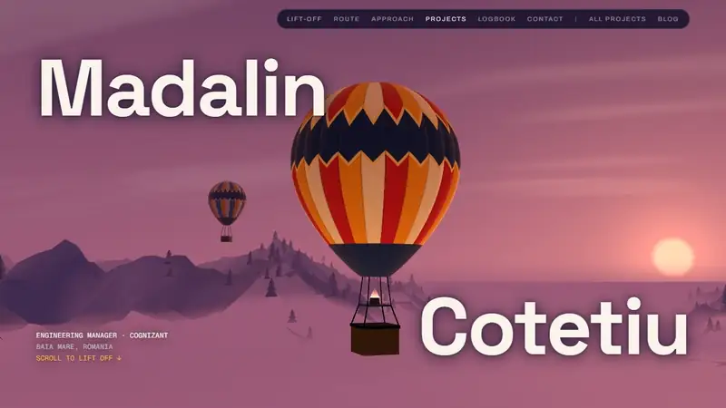</a>
      <br><b>Madalin Cotetiu</b><br>
      <sub>A career as one balloon flight, from violet pre-dawn to a lantern-lit landing</sub><br>
      <sub><a href="https://cotetiu-madalin-parallax-portfolio.vercel.app">Live</a> · <a href="docs/media/film-madalin.mp4">MP4</a></sub>
    </td>
    <td width="33%" align="center">
      <a href="https://zsolt-kiss-portfolio.vercel.app">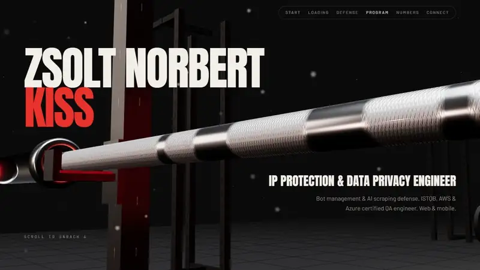</a>
      <br><b>Zsolt Norbert Kiss</b><br>
      <sub>An IP protection engineer as a lifting session: one barbell, loaded plate by plate to a new PR</sub><br>
      <sub><a href="https://zsolt-kiss-portfolio.vercel.app">Live</a> · <a href="docs/media/film-zsolt.mp4">MP4</a></sub>
    </td>
    <td width="33%" align="center">
      <a href="https://ionut-ghit-portfolio.vercel.app">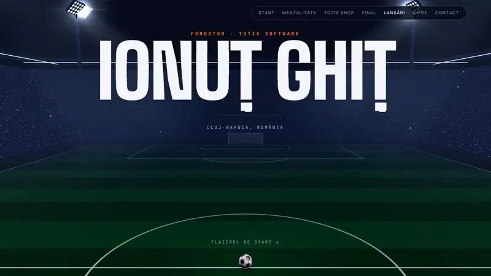</a>
      <br><b>Ionuț Ghiț</b><br>
      <sub>An ecommerce founder as a night match under stadium lights, written in Romanian</sub><br>
      <sub><a href="https://ionut-ghit-portfolio.vercel.app">Live</a> · <a href="docs/media/film-ionut.mp4">MP4</a></sub>
    </td>
  </tr>
</table>

### 📰 Editorial: *a studio's journal, set on screen*

Type-led and calm, on a paper ground: big serif headings, mono labels, hairline rules, numbered
sections and an index of work with generated covers. One sculptural object, the *specimen*, sits in the
margin and turns as chapters change. Here, a stack of steel gauge blocks that lift apart one per step.

<table>
  <tr>
    <td width="62%">
      <a href="https://madalin-cotetiu-editorial-portfolio.vercel.app">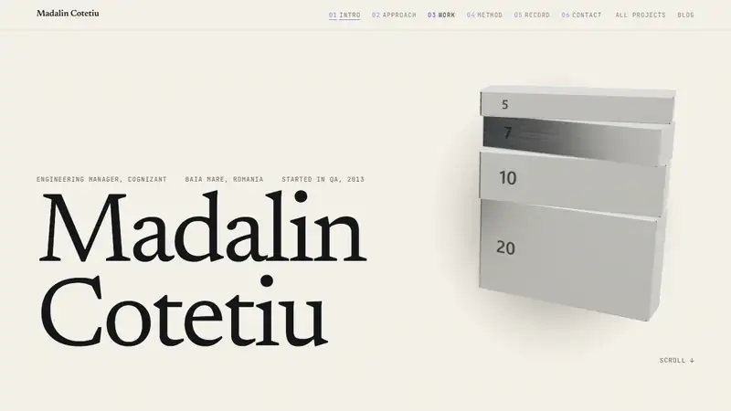</a>
    </td>
    <td width="38%">
      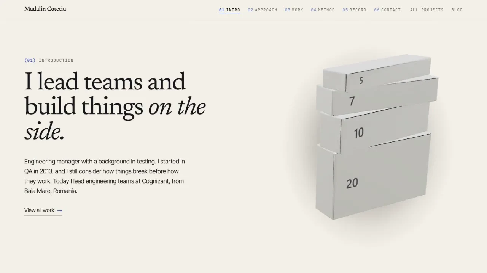
      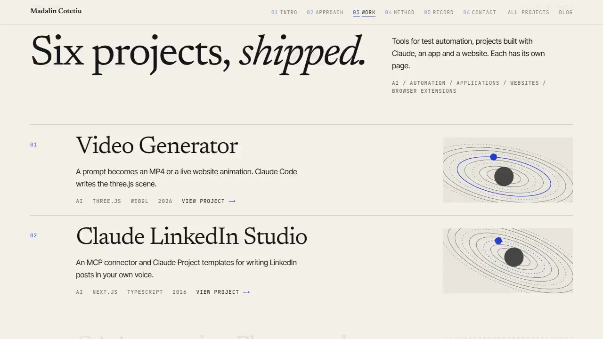
    </td>
  </tr>
</table>

<sub>Inspired by studio sites like <a href="https://glinto.co.kr/en">Glinto</a> and <a href="https://thecontenders.co/work">The Contenders</a>.
&nbsp;<a href="https://madalin-cotetiu-editorial-portfolio.vercel.app"><b>Live</b></a> · <a href="docs/media/editorial-madalin.mp4">MP4</a></sub>

### 📡 Signal: *a control room for a brand*

Dark, with one electric accent and an interface that feels live: a loader counting from `000%`,
`STATUS //` readouts, a live local clock, a scroll counter, marquees, bordered cells and a giant
wordmark. At its center is one dramatic *artifact*, here an obsidian specimen with a machined core,
which a lime scan passes through and the page opens step by step.

<table>
  <tr>
    <td width="62%">
      <a href="https://madalin-cotetiu-signal-portfolio.vercel.app">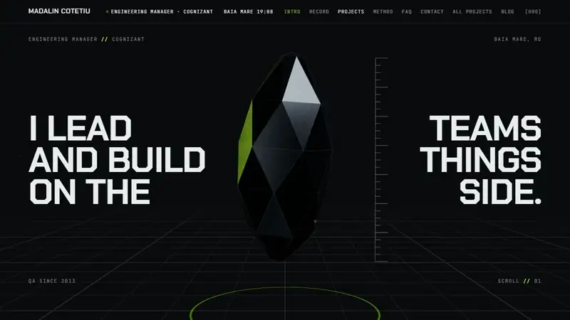</a>
    </td>
    <td width="38%">
      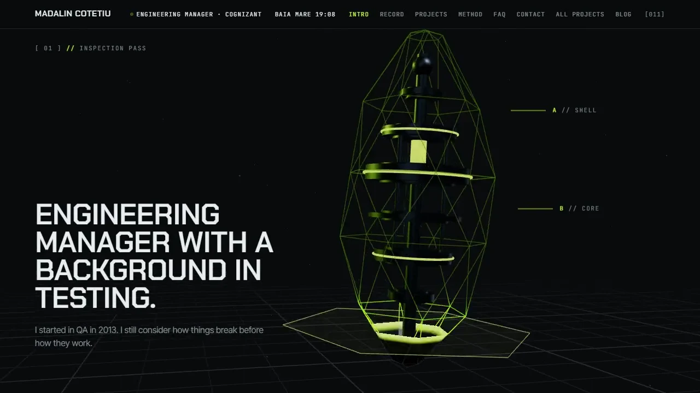
      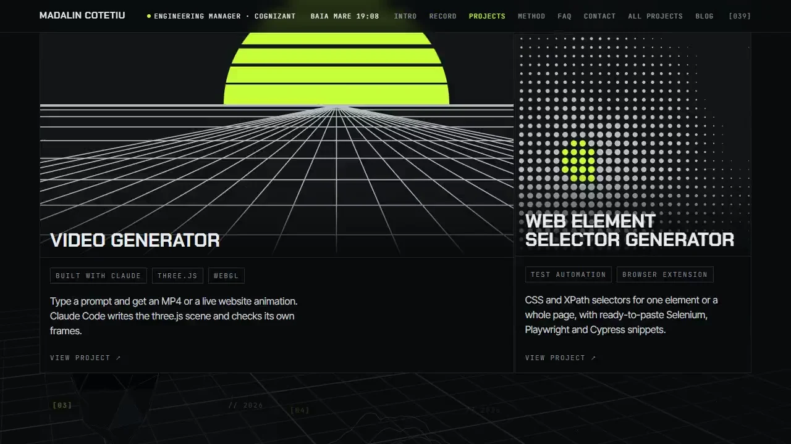
    </td>
  </tr>
</table>

<sub>Inspired by studio sites like <a href="https://www.allerstudio.com/">Aller</a>.
&nbsp;<a href="https://madalin-cotetiu-signal-portfolio.vercel.app"><b>Live</b></a> · <a href="docs/media/signal-madalin.mp4">MP4</a></sub>

| | 🎬 Film | 📰 Editorial | 📡 Signal |
|---|---|---|---|
| **Ground** | The 3D world itself | Paper | Near-black |
| **Type** | Characterful display, plain body | Serif, grotesk and mono | Uppercase technical display and mono readouts |
| **The 3D** | A world the camera travels through | A specimen in the margin | An artifact at the center, scanned and opened |
| **Pinned** | Almost everything | The hero, and at most one case study | The hero, plus one or two big moments |
| **Menu** | A pill of chapters | A bar with numbered chapters | A HUD bar with status, clocks and `[042]` |
| **Best for** | Products, places, journeys | Studios, practices, people | Technical, bold or nocturnal brands |

> The same person, Madalin, in all three styles: the [balloon flight](https://cotetiu-madalin-parallax-portfolio.vercel.app),
> the [journal](https://madalin-cotetiu-editorial-portfolio.vercel.app) and the [control room](https://madalin-cotetiu-signal-portfolio.vercel.app).
> Same facts and projects, three completely different sites.

---

## Quick start

```bash
npm install
npm run create
```

A setup page opens in your browser. It asks about your project, which **style** you want and, if you
have one, your existing site's public GitHub repo. Then you choose sections, theme, colors, fonts and art
direction, and press **Create site**. Answering uses none of your Claude usage, and when the site is
built, the page gives you a link to it.

<details>
<summary><b>Prefer one line?</b></summary>

```bash
npm run site -- "a site for a fictional mechanical watch, dark and precise"
npm run site -- --style editorial "a portfolio for a small ceramics studio"
npm run site -- --style signal "an independent AI lab in Cluj, precise and a little dramatic"
```

Or type `/site <brief>` in Claude Code. Without a style, `/site` picks one from the brief and says why.
</details>

### What it costs

Answering the setup page is free. Generating draws on your Claude Code usage, with no additional cost.

| Run | Style | Sections | Time | Tokens |
|---|---|---|---|---|
| Madalin, first site | Film | 7 | ~24 min | 5.4 M |
| Madalin | Editorial | 6 | ~10 min | 3.2 M |
| Madalin | Signal | 6 | ~13 min | 4.0 M |

---

## How it works

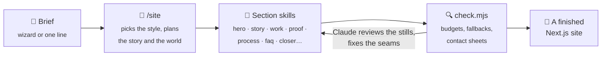

The page has **one fixed canvas, one scene and one camera**. Each section adds an *act* to that scene,
and the engine eases the camera, a shared object and the mood between acts as you scroll, so sections
read as one continuous piece rather than a stack of embeds.

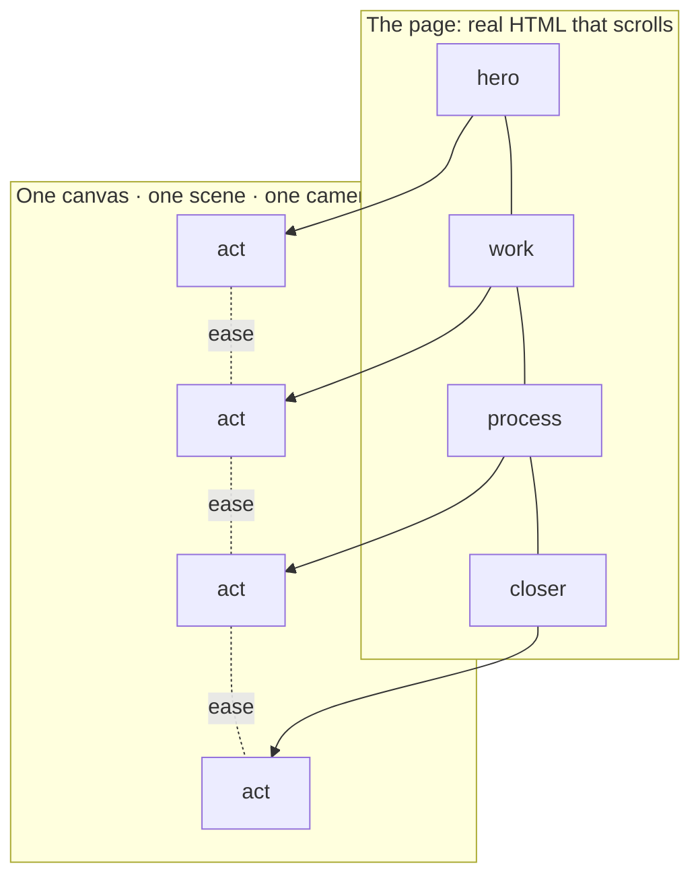

**Rules every style keeps:**

- 🔁 The look depends only on scroll, time and the pointer, so scrolling back undoes everything.
- ♿ The page works with no JavaScript, with reduced motion and without WebGL.
- ⚡ three.js loads after first paint, in its own chunk, and the budgets run on an integrated GPU.
- 🎨 Everything on screen is code. Covers are generated SVG, and objects and worlds are procedural.
- 🧾 For a real person or business, no invented facts: anything unknown becomes a `[placeholder]`.

---

## The skills

| Skill | Builds |
|---|---|
| `/site` | The whole site: picks the style, plans the story and world, calls the skills below, then fixes the seams |
| `/section-hero` | The opening and the first reveal |
| `/section-story` | A long pinned sequence, the main event |
| `/section-statement` | One huge line of type (in Editorial, a manifesto paragraph) |
| `/section-features` | Cards, a list or numbered cells for details or services |
| `/section-work` | An index of projects or case studies with tags and generated covers |
| `/section-process` | How the work happens, as numbered steps |
| `/section-gallery` | A sideways run of procedural plates |
| `/section-proof` | Numbers, quotes and names |
| `/section-faq` | Questions as an accordion that needs no JavaScript |
| `/section-closer` | The final image, the call to action and the footer |

Each section skill also works alone, for example `/section-statement slug=claim: "Nothing is wasted"`,
and builds in the site's current style. The guides they follow live in
[`.claude/skills/site/styles/`](.claude/skills/site/styles/).

### Building blocks

| Block | What it does |
|---|---|
| `Section` · `Beat` · `Depth` · `Words` | Pinned sections, timed beats, parallax layers and rising words |
| `Reveal` | Flowing content that rises in as it scrolls into view |
| `Count` | A number counting up as it arrives, with the final value in the markup |
| `Marquee` | An endless row, such as skills or client names |
| `LocalTime` | The time now in a city |
| `Plate` | Generated SVG cover art in the site's colors: `ridges` `orbits` `horizon` `halftone` `spectrum` `stack` `glyph` |

---

## Checks

```bash
npm run check                        # everything, with a contact sheet per section
npm run check -- --section work      # one section's sheet
```

It builds the site, opens it in headless Chrome on the integrated GPU, and fails on:

| | |
|---|---|
| 🧱 Broken builds and browser errors | 🌐 Any request off the site |
| ⏱️ Frame time over 14 ms median or 24 ms p95 | 📦 More than 600 KB downloaded |
| ↔️ Sideways scrolling | 🔤 Text off screen, overlapping or under the menu |
| ♿ Text lost with reduced motion | 🚫 Text lost without JavaScript or WebGL |

Then it writes contact sheets to `checks/`, and Claude reads them, critiques them and fixes what's wrong.

---

## Your existing site

Add a public GitHub repo to the setup page, and the new site can use its colors, fonts and wording. Your
repo isn't changed, and its code is never checked out, installed or run: the setup page only reads
selected text files. Each new site saves the previous one to `.archive/`.

## Project layout

```
.claude/skills/
  site/            /site, the contract, and styles/ (film.md, editorial.md, signal.md)
  section-*/       one skill per kind of section
src/stage/         the shared engine: clock, WebGL engine, blocks, plates, chrome per style
src/site/          this site's brief, tokens, fonts, world and section order   (generated)
src/sections/      each section's page content and its act in the 3D          (generated)
content/           Markdown for /projects and /blog
scripts/           check.mjs, the setup wizard, and capture.mjs for these previews
docs/media/        the previews in this README
```

The previews were recorded from the live sites with `node scripts/capture.mjs <url> <name>`, which steps
each site's own scroll clock frame by frame and writes a WebP, an MP4 and stills.

## Limitations

- Everything is procedural, so a site that depends on photographs needs a different idea. In Editorial and
  Signal, generated plates stand in for project images.
- Claude reviews stills, not playback. A person still has to scroll through it.
- It generates one site per copy of this project. Keep each site on its own branch.

<div align="center">
<br>
<sub>Made with Claude Code · three.js · Next.js. Every pixel on these sites is code.</sub>
</div>
